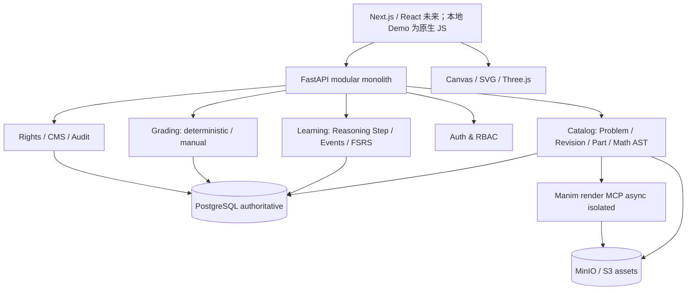

# LeetMath 实施路线：独立本地 MVP → 正式 Phase 1.5 → Phase 2/3

## 1. 架构分层



选模块化单体而不是过早拆微服务。静态样例与本地动图缓存不应让用户练习依赖现场渲染。后台 Python 判题/CAS、未来 Manim MCP 用不同无网络沙箱，前台 JS 不执行不可信题库代码。

## 2. 决策优先级（不是已完成进度）

| 里程碑 | 交付 | 验收门槛 |
|---|---|---|
| R0（目标；原型源码未随本仓库发布） | 3 道原创大题、9 小问、28 张推理卡、本地注册/登录、自评步骤、雷达、复习、2D/3D 组件 | 目标：Pytest 集成用例通过；浏览器实测（含 WebGL 降级）待执行 |
| R1 规范冻结 | 改 LeetMath PRD、MathContentContract 加 StepRevision/ReasoningCard 合同，迁移清单、教师打分说明 | 逻辑层版本身份可追溯；20 道样例步骤人工复核 |
| R2 PostgreSQL | Alembic 正式迁移、seed 导入、不可变历史、真实用户表、权限、权益状态 | 一次导入重放无重复；不同用户 IDOR/CSRF 等测试通过 |
| R3 一体化练习前端 | Next.js + KaTeX/MathJax 选一、3D/2D 根据 semantic_geometry 自动渲染、移动端无障碍 | 375px/桌面、Chrome/Firefox/Safari 系列交互通过；WebGL fallback |
| R4 FSRS 和客观验证 | 真实 FSRS 集成，题目步骤修订兼容，客观独立作答与自评分开展示 | 事件重放与参数版本可追踪，黄金数学答案用例通过 |
| R5 知识画像与推荐 | 异构学习证据模型、先修图、变式题、短板解释、课程进度与教师分析 | 7/14 天跨题迁移测验有定义明确的 A/B 实验与基线 |
| R6 教师制作闭环 | CMS Step Editor、Manim 分镜与 MP4、可编辑 Three 场景生成 | 源/版权/审校/发布/回撤整链路可复现 |

建议从 R1 建立合同开始，R2/R3 并行推进，R4 不得在没有明确复习事件语义时强上 FSRS。将现有 Phase 1 的 `SourceRegistry → Rights → 审校 → 发布` 当前置条件，不用本地 demo 绕过该门禁做公网产品。

## 3. 分模块交付清单与依赖

- `domain/catalog`: 将原 SQLite 三题映射至发布不可变 Revision + Part；`MathRichText` blocks；题目源/授权。
- `domain/reasoning`: StepVersion、Cue、依赖图、评分点映射；原题与改编同构题关系。
- `domain/learning`: ReviewEvent、Schedule、TopicFeedback、Evidence；重放、幂等、撤回补偿。
- `domain/judging`: 可靠的安全数字和符号判题，证明题人工复核，不假装自动证明。
- `domain/geometry`: 统一 `semantic_geometry`：对象点、线、面、关系、几何参数、辅助坐标、默认视图、操作事件；2D/3D 通用 renderer adapters。
- `domain/teacher`: steps/editor、双审、分值守恒验证、Manim 资源与题源治理。
- `domain/identity`: 本地账户迁移、学生/教师角色、session revoke、学校 tenant（若需求成立）。

## 4. 本地运行与开发验收

> 注：以下脚本、依赖清单与测试文件（`requirements.txt`、`scripts/run-local.sh`、`scripts/vendor-frontend.sh`、`tests/test_app.py`、docker compose）**尚未包含在本仓库中**，属于 R1 待交付清单；仓库当前只有设计文档与 SQL 草案。

```bash
python -m venv .venv
source .venv/bin/activate
pip install -r requirements.txt
./scripts/run-local.sh
# http://127.0.0.1:8765/
```

或 `docker compose up --build -d`。默认联网加载 KaTeX + Three CDN。完全离线先用 npm 执行 `./scripts/vendor-frontend.sh` 下载本地静态包，然后构建/启动。

集成测试：`pytest -q tests/test_app.py`；覆盖账户、CSRF/隔离、固定示例内容和总分、9 步完整训练、3 个知识点自评、重复提交幂等、到期复习、当日 XP 防刷、静态资源。不包括真正浏览器 WebGL 渲染，必须在用户本机手动验收。

## 5. 风险清单与优先修复

| 风险 | 等级 | 对策 |
|---|---|---|
| 把自评变成真实成绩 | 严重 | 两套数据源、两套指标名，醒目标识“主观自评” |
| 未审核 AI 解题步骤数学错误 | 严重 | rubric / graph / reference_solution 发布前教师复核 |
| 草稿/受限题被公开 | 严重 | 生产 rights gate、私有对象、按使用场景逐请求鉴权 |
| 自定义 LaTeX/SVG/3D 对象不可信 | 严重 | CSP、DOM 净化、图元白名单、不得执行题目提供的 JavaScript |
| 账号撞库、数据丢失 | 高 | HTTPS、限流、密码恢复、备份恢复、监控、学校数据隔离 |
| 用户只是背了原题步骤 | 高 | 兄弟卡埋藏、随机变式、知识迁移独立测验 |
| 3D WebGL 兼容性问题 | 中 | Three.js 惰性加载，视角预设，离线与低性能 SVG fallback |
| 游戏化让学生乱点知道 | 高 | XP 与正确性、自评评级独立，反馈指标可校准 |
| FSRS 与三选项不兼容 | 中 | 显式保留原 rating，训练模型前不宣传 FSRS |
| 移动端公式和图片溢出 | 中 | 大公式独立滚动、图形尺寸约束、图像变焦与 alt |