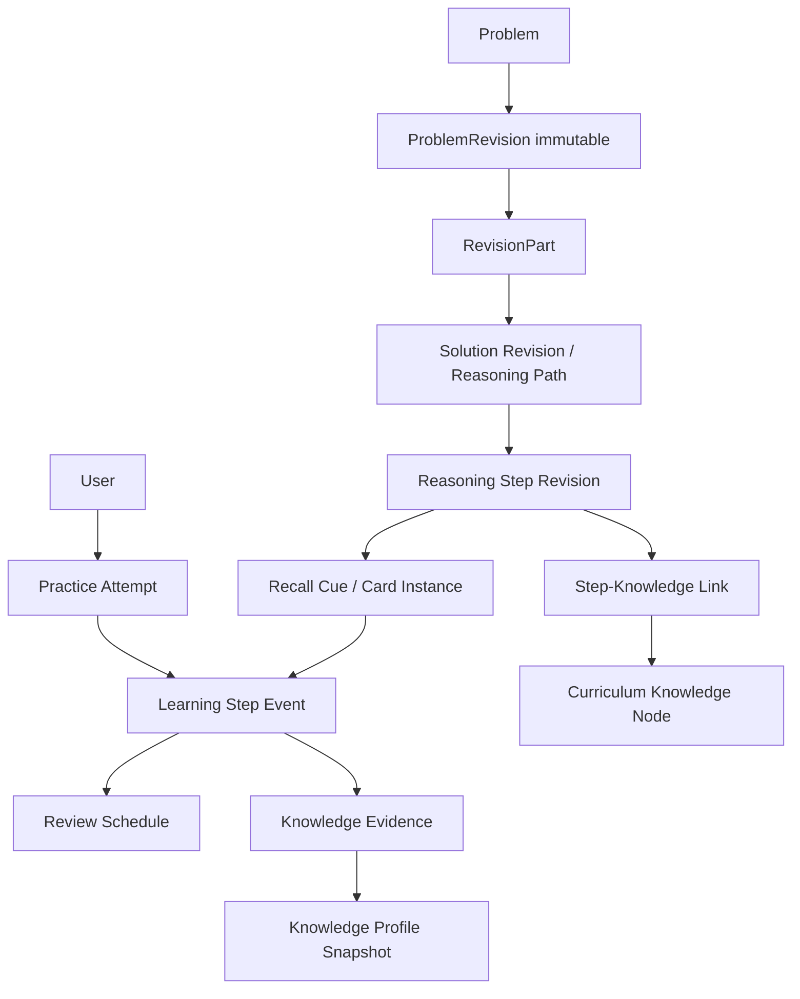

# Learning Domain Schema：从数学题库到步骤自适应复习

## 1. 数据所有权与兼容性

长期生产实现须复用 LeetMath `docs/04-data-model.md` 的 `problems`, `problem_revisions`, `logical_parts`, `revision_parts`, `solutions`, `answer_specs`, `rubrics`, `knowledge_nodes`, `attempts`, `submissions`, `evaluations`, `users`；本模块只添加可追溯的练习层实体。当前演示 SQLite 为便于直接运行，加了 `app_` 前缀，保留导入题库的旧表结构，**不能直接视为 LeetMath PostgreSQL 完整 DDL**。

保留内容身份链：



### 1.1 建议核心表

| 表 | 主键与外键 | 核心字段 / 约束 |
|---|---|---|
| `reasoning_paths` | id, revision_part_id, solution_id | approach, validation_status, reviewer_id, published_at, immutable content hash |
| `reasoning_steps` | id, path_id, semantic_key | step_order, version, dependency graph, math display, reference answer, recall cue, criticality, status |
| `step_criteria_links` | step_id, rubric_criterion_id | score_weight, rationale, sum normalized to part.max_score; no inferred points |
| `step_knowledge_links` | step_id, knowledge_node_id | relation tested/prerequisite/related, weighting, reviewer, curriculum_release |
| `step_dependencies` | (step_id, prerequisite_step_id) | DAG edges, cycle detection at publish |
| `learning_attempts` | id, user_id, revision_id | sequence_policy, state, started_at, ended_at, renderer_version |
| `learning_attempt_cards` | (attempt_id, sequence_no) | step_id, allocated_max_points, content_revision snapshot |
| `step_review_events` | id, user_id, attempt_id, card_id | grade, reveal/hint, answer_trace, source, max_score, earned_self_score, occurred_at, idempotency_key |
| `knowledge_self_assessments` | id, user_id, attempt_id, knowledge_node_id | 1–4 confidence, explicitly self-reported |
| `step_review_state` | (user_id, step_id, scheduler_version) | due_at, stability, difficulty, review_count, last_grade |
| `knowledge_evidence` | id, user_id, knowledge_node_id, source_event_id | source_type, evidence_weight, observed_result, checker_version, model_version |
| `knowledge_state_snapshots` | (user_id,knowledge_node_id,model_version,computed_at) | mean, uncertainty, evidence_count, reasons, input_hash |
| `learning_xp_awards` | (user_id, step_id, local_day, reward_type) | earned integer, daily cap, no penalty for unsure |
| `recommendation_runs` | id, user_id | input_snapshot_hash, model_version, candidate scores, selected step, rationale |

### 1.2 最小数据契约示例

```json
{
  "schema_version": "reasoning-1.0.0",
  "part_revision_id": "<revision-parts-uuid>",
  "path": {"id": "<path-uuid>", "approach": "椭圆代入与最值"},
  "steps": [
    {
      "id": "<step-uuid>",
      "semantic_key": "ellipse_area_square",
      "order": 2,
      "recall_cue": "怎样去掉面积公式中的绝对值，使最值更容易求？",
      "reference_math_latex": "S^2=4t^2(1-t^2/9)",
      "criticality": "key",
      "rubric_criterion_ids": ["AREA-C2"],
      "max_points": "3.00",
      "knowledge_links": [
        {"code": "SH-HS-ANAG-OPTIMIZATION", "relation": "tested", "weight": "1.00000"}
      ],
      "depends_on": ["ellipse_area_formula"]
    }
  ]
}
```

数学 AST 与 LaTeX 分离存储。稳定 `semantic_key` 是单个教学路径的概念标识，不允许替代唯一 UUID；数学语义不变的显示修改可映射 lineage，但学生事件永远绑定发布时的具体 step revision。

## 2. 关键设计判断

1. **审校权重先于算法**。Step `max_points` 必须与 Rubric 关联；不可凭一句话长度/公式复杂度自动给分。`criticality` 必须有教研理由，最终本小问的分配总和守恒。
2. **一道小问多解法**。算法不能把 A 路径和 B 路径的步骤全合并成一次测试；每轮选择一个 pathway，记录 `reasoning_path_id`，可用同构不同解法交叉复习。
3. **知识标签与专有知识节点**。tags 为复合搜索过滤，可自由扩展；计算能力只使用已经审校的知识节点及关系权重。
4. **权利透传**。所有 Reasoning Card / 参考图 / 变式资产继承底层素材的来源使用许可；公网上线前以 LeetMath 原 rights gate 逐个检查。撤稿要同时使卡片不可见，但严格保留必要的学习汇总而不泄漏受限原文。
5. **事件追加**。用户点错按钮若支持撤销，写 correction event；禁止编辑历史 review 以便审计、训练模型与重算。
6. **用户与学校隔离**。生产版本每张学习表有 user_id 或通过复合 FK 关联 owner；请求权限在数据库查询条件中表达，不只依靠页面隐藏。
7. **调度算法可替换**。scheduler_version 与配置快照决定 FSRS 兼容性；改模型只重算未来 due，不更改旧事件。
8. **幂等与时区**。写操作携带客户端 UUID；服务器唯一约束；时间存 timestamptz UTC，按用户时区聚合日历，避免 DST 或跨日误差。

## 3. 可直接参考的 PostgreSQL 追加 DDL

`postgres_learning_extension.sql` 仅负责学习领域，含必要 FOREIGN KEY，可在**LeetMath 主库真实建表并迁移后**作为设计起点。依赖其 `users`、`revision_parts`、`problem_revisions`、`knowledge_nodes` 物理表存在，不能在一个空数据库里单独运行。

## 4. 旧 SQLite → 正式 PostgreSQL 映射

| 演示 SQLite | 正式 LeetMath | 迁移关键动作 |
|---|---|---|
| `questions` | `problems` | `code` 映射 `display_id` 并建立 UUID 稳定 id |
| `question_versions` | `problem_revisions` | `version_no` 与源数学模型分开，保证发布不可变 |
| `question_parts` | `logical_parts` + `revision_parts` | 同时建立语义小问 ID 与版本小问 ID |
| `solutions.steps` JSON | `solutions` + `reasoning_paths` + `reasoning_steps` | 每步析为独立行；保留原始 JSON 哈希、reviewer 和 provenance |
| `knowledge_points` | `knowledge_nodes` in curriculum_release | 代码 + 版本映射，经教师审核避免误合并 |
| `app_users` | `users` + identity provider/auth tables | 保留同一用户稳定 ID；重新设计正规认证与隐私政策 |
| `app_step_events` | `step_review_events` | 保存原自评分、版本和事件历史，不写正式 evaluations |
| `app_topic_assessments` | `knowledge_self_assessments` | 自评证据独立存储，不当真实成绩 |
| `app_review_schedules` | `step_review_state` | 切换 FSRS 时历史事件重放，不复用旧启发式稳定度 |
| `app_xp_awards` | `learning_xp_awards` | 贡献型 XP，按事件唯一、按天限制 |

## 5. API 契约（建议 `/api/v1/learning`）

| 方法 + 路由 | 用途 | 幂等与权限 |
|---|---|---|
| `GET /cards/due?tag=...` | 查询当日到期卡 | 返回具版权许可的卡片元数据，用户所有权 |
| `POST /attempts` | 创建练习，冻结本轮卡片顺序和版本 | 重试用 Idempotency-Key |
| `GET /attempts/{id}` | 展示已完成历史和当前 cue，不泄露未揭晓参考答案 | 必须校验本人 |
| `POST /attempts/{id}/step-reviews` | 提交 know/fuzzy/unsure 或实际步骤作答 | 唯一 `event_id`，追加式事件，CAS 防重复 |
| `POST /attempts/{id}/knowledge-feedback` | 整题知识点自评与完成 | `knowledge_node_id` 必须由 tested links 计算 |
| `GET /profile/learning` | 雷达、趋势、证据、薄弱点 | 区分自报与测验测量 |
| `GET /recommendations` | 当前最值得复习的卡 | 返回理由、scheduler/model version、候选 ID |

后续可将学生独立输入提交到原有 `submissions`/`evaluations` 判题服务，不必改写上述自评 API。